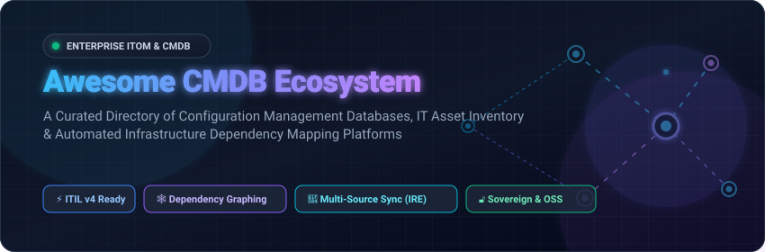

<p align="center">
  
</p>

<p align="center">
  <a href="https://github.com/ishandutta2007/Awesome-Awesome-Awesome"></a>
  <a href="https://discord.gg/jc4xtF58Ve"></a>
  <a href="https://github.com/ishandutta2007/Awesome-Configuration-Management-Database-CMDB/stargazers"></a>
  <a href="https://github.com/ishandutta2007/Awesome-Configuration-Management-Database-CMDB/network/members"></a>
  <a href="https://github.com/ishandutta2007/Awesome-Configuration-Management-Database-CMDB/blob/main/LICENSE"></a>
  <a href="https://github.com/ishandutta2007/Awesome-Configuration-Management-Database-CMDB/pulls"></a>
  <a href="https://github.com/ishandutta2007"></a>
</p>

---

# 🌐 Awesome Configuration Management Database (CMDB)

> **The Definitive Ecosystem Guide to Enterprise SaaS Platforms & Open-Source IT Infrastructure Configuration Repositories.**  
> *Track Configuration Items (CIs), Dynamic Dependency Mapping, Identification & Reconciliation (IRE), and ITIL Service Impact Analysis.*

A **Configuration Management Database (CMDB)** serves as the authoritative single source of truth for an enterprise's IT landscape. It maintains a unified, relationship-aware record of all **Configuration Items (CIs)**—including virtual machines, physical servers, network topology, cloud microservices, software builds, and business services. Modern CMDBs power rapid incident diagnosis, automated root-cause analysis (RCA), change risk assessment, regulatory audit compliance, and IT asset management (ITAM).

---

## 📑 Table of Contents

- [📊 Sector Overview & Market Dynamics](#-sector-overview--market-dynamics)
- [☁️ Top SaaS & Hosted CMDB Platforms](#️-top-saas--hosted-cmdb-platforms)
- [🔓 Open-Source GitHub Projects & Sovereign CMDBs](#-open-source-github-projects--sovereign-cmdbs)
- [🏗️ CMDB Architecture & Evaluation Criteria](#️-cmdb-architecture--evaluation-criteria)
- [❓ Frequently Asked Questions (FAQ)](#-frequently-asked-questions-faq)
- [🤝 How to Contribute](#-how-to-contribute)
- [💖 Support & Community](#-support--community)
- [⭐ Star History](#-star-history)
- [⚖️ Disclaimer](#️-disclaimer)

---

## 📊 Sector Overview & Market Dynamics

The global **Configuration Management Database (CMDB)** and IT Operations Management (ITOM) market is estimated at **$4.8 billion in 2024**, projected to surpass **$11.2 billion by 2030**, expanding at a Compound Annual Growth Rate (**CAGR of ~14.5%**). This acceleration is fueled by multi-cloud infrastructure sprawl, Kubernetes microservice topologies, and AI-assisted root-cause analysis (AIOps).

### Market Concentration & Competitive Landscape
- **Concentrated Enterprise Apex (Winner-Takes-Most)**: The Fortune 2000 and Global Tier-1 enterprise tier is heavily concentrated, dominated by **ServiceNow** and **BMC Software**, who together command over **55%** of large enterprise ITIL deployments due to deep multi-source Identification & Reconciliation Engines (IRE), proprietary MID server architectures, and extensive service catalog ecosystems.
- **Moderately Fragmented Mid-Market & Cloud-Native Tiers**: The mid-market, SME, and cloud-first segments exhibit **moderate fragmentation**. Specialized competitors such as **Freshworks (Device42)**, **ManageEngine**, **SolarWinds**, and **Lansweeper** compete intensely on rapid time-to-value, transparent pricing, and agentless discovery probes.
- **Rapidly Growing Sovereign & Open-Source Tier**: Driven by data sovereignty mandates, strict air-gapped environments, and avoidance of per-node licensing taxes, open-source platforms like **NetBox**, **GLPI**, **Snipe-IT**, and **Atlas CMDB** represent a surging self-hosted alternative for modern platform engineering and DevOps teams.

---

## ☁️ Top SaaS & Hosted CMDB Platforms

Below is the verified breakdown of the industry's category leaders, **sorted descending by Company Size (Valuation / Revenue)**. Specific entry tier pricing and exact free trial / free tier limits are detailed for each platform:

| 🏢 Platform / Vendor | 📈 Company Size (Revenue / Valuation) | 💰 Specific Starting Pricing | 🎁 Free Tier & Trial Limits | 🔍 Key CMDB & Dependency Mapping Capabilities |
| :--- | :--- | :--- | :--- | :--- |
| **[ServiceNow CMDB](https://www.servicenow.com/)** | **~$190B Market Cap**<br>*(FY24 Revenue: $10.98B)* | **$100 / fulfiller / month**<br>*(ITSM Foundation baseline with CMDB; ITOM Discovery add-on ~$3.50 / node / month)* | **15-Day Enterprise Trial**<br>*(Free Personal Developer Instance [PDI] with schema access, reclaims after 10 days inactivity)* | Centralized enterprise CMDB featuring CMDB Health benchmarks, Identification & Reconciliation Engine (IRE), Service Graph Connectors, and MID Server agentless probes (SSH, SNMP, WMI). |
| **[Insight Discovery (Jira Assets)](https://www.atlassian.com/software/jira/service-management)** | **~$50B Market Cap**<br>*(FY24 Revenue: $4.40B)* | **$20.00 / agent / month**<br>*(Jira Service Management Standard with Assets; Premium tier with AIOps at $51.42 / agent / mo)* | **Free Forever Plan**<br>*(Up to 3 agents, 2 GB storage, basic asset schema); 7-day free trial for Premium tier* | Native Jira integration, automated agentless network discovery sweeping subnets via WMI/SNMP, object schema designer, visual impact dependency graphing, and ITIL change risk scoring. |
| **[ManageEngine ServiceDesk Plus](https://www.manageengine.com/products/service-desk/)** | **~$12B Valuation**<br>*(Zoho Corp Revenue: $1.40B+)* | **$13 / technician / month**<br>*(Standard; Professional with ITAM & Discovery at $27 / tech / mo; Enterprise full CMDB at $67 / tech / mo)* | **Free Forever Plan**<br>*(Up to 5 technicians & 300 IT assets); 30-day Enterprise free trial (unlimited technicians & assets)* | Drag-and-drop visual relationship canvas, automated discovery probes (Windows domain, script, agent), CI baselining for configuration drift tracking, and CMDB Data Doctor AI quality checks. |
| **[BMC Helix CMDB](https://www.bmc.com/it-solutions/bmc-helix-cmdb.html)** | **~$8.5B Valuation**<br>*(KKR / FY Revenue: $2.30B)* | **$95 / user / month**<br>*(Entry ITSM & CMDB seat license, billed annually with baseline starting commit of ~$10,000 / year)* | **30-Day Sandbox Trial**<br>*(Interactive BMC Helix Cloud sandbox pre-populated with CI dependency models and sample topologies)* | Enterprise single-source-of-truth CMDB, dynamic impact simulation, multi-source data reconciliation, dataset partitioning, and HelixGPT-assisted configuration drift monitoring. |
| **[Freshservice CMDB](https://www.freshworks.com/freshservice/)** | **~$4.2B Market Cap**<br>*(FY24 Revenue: $720M)* | **$19 / agent / month**<br>*(Starter tier; includes 100 Asset Units free; Growth at $49/agent; additional 500 AU packs at $125 / month)* | **14-Day Free Trial**<br>*(Fully featured Pro plan including up to 100 managed assets, Discovery Agent, and visual relationship canvas)* | Cloud-native CMDB with auto-discovery probes, visual CI relationship mapping, audit-ready change activity logs, and real-time service dependency tracking tied to incident tickets. |
| **[SolarWinds Service Desk](https://www.solarwinds.com/service-desk)** | **~$2.4B Market Cap**<br>*(FY24 Revenue: $780M)* | **$39 / technician / month**<br>*(Essentials tier; Advanced at $99/tech; Premier tier with Visual CMDB & Dependency Mapping at $124 / tech / mo)* | **30-Day Free Trial**<br>*(Full premier access, unlimited end-user requesters, up to 500 managed nodes/devices, and auto-discovery)* | Visual CMDB Map depicting upstream/downstream CI dependencies, risk and impact simulator for planned changes, automated discovery agent, and configuration drift detection. |
| **[Lansweeper](https://www.lansweeper.com/)** | **~$400M Valuation**<br>*(Annual Revenue: ~$90M)* | **$239 / month**<br>*(Starter plan billed annually at $2,868/yr for up to 2,000 assets; Pro plan at $439 / month)* | **Free Forever Plan**<br>*(Up to 100 scanned IT/network assets with full inventory); 14-day Pro trial (up to 2,000 assets)* | Deep agentless network scanning (OT, IoT, IT, cloud), automated hardware/software inventory, warranty and lifecycle tracking, and API federation into downstream ITSM CMDBs. |
| **[Device42](https://www.device42.com/)** | **$230M Valuation**<br>*(Acquired by Freshworks; Rev: ~$40M)* | **$121 / month**<br>*(Core tier billed annually at $1,449/yr for up to 100 devices and 1,000 IPs; scales to ~$0.50 / device / month)* | **14-Day Free Trial**<br>*(Full automated discovery, Application Dependency Mapping [ADM], and CMDB graphing up to 1,000 devices)* | Hybrid-cloud CMDB with agentless discovery, Application Dependency Mapping (ADM), EnrichAI data normalization with EOL/EOS vulnerability context, DCIM rack layouts, and IPAM. |
| **[Virima](https://virima.com/)** | **~$15M Revenue**<br>*(Private / Bootstrapped)* | **$395 / month**<br>*(Business Pro tier billed annually at $4,740/yr for up to 2,000 assets/CIs; includes ViVID™ Mapping)* | **30-Day Free Trial**<br>*(Full cloud trial supporting discovery of up to 250 network devices, servers, and visual service maps)* | Automated agentless multi-vendor discovery (Cisco, VMware, Oracle, AWS, Azure), ViVID™ dynamic service mapping, unauthorized CI dashboard alerts, and bidirectional ServiceNow synchronization. |
| **[Alloy Navigator](https://www.alloysoftware.com/)** | **~$8M Revenue**<br>*(Private / Bootstrapped)* | **$19 / technician / month**<br>*(Explorer tier up to 3 techs; Express at $49/tech/mo; Enterprise with full ITIL CMDB at $86 / tech / mo)* | **30-Day Free Trial**<br>*(Fully functional Alloy Cloud instance with up to 5 technician seats and unlimited Configuration Items)* | ITIL-aligned change and configuration management, graphical relationship mapping, automated network inventory discovery, and workflow process automation engines. |

---

## 🔓 Open-Source GitHub Projects & Sovereign CMDBs

Self-hosted, open-source configuration databases allow engineering teams to maintain full ownership of infrastructure data without per-seat or per-node subscription lock-in. 

The entries below are **sorted descending by GitHub Star Count**, with direct links to each repository's stargazers page:

### 1. [NetBox](https://github.com/netbox-community/netbox) [](https://github.com/netbox-community/netbox/stargazers)
- **Primary Domain**: Network Source of Truth, DCIM, IPAM & Network CMDB.
- **License**: Apache 2.0 | **Tech Stack**: Python, Django, PostgreSQL, Redis.
- **Key Capabilities**: The industry standard for network infrastructure modeling. Defines sites, racks, physical device bays, cabling paths, IP allocations, VLANs, VRFs, and virtualized workloads. Powers automated network configuration generation and event-driven webhooks.

### 2. [Snipe-IT](https://github.com/snipe/snipe-it) [](https://github.com/snipe/snipe-it/stargazers)
- **Primary Domain**: IT Asset Management (ITAM) & Configuration Item Lifecycle.
- **License**: AGPL-3.0 | **Tech Stack**: PHP, Laravel, MySQL.
- **Key Capabilities**: Manages physical enterprise hardware, software licenses, accessories, and user assignments. Features QR/barcode generation, asset auditing workflows, LDAP/SAML synchronization, Slack/Teams notifications, and a comprehensive REST API.

### 3. [GLPI](https://github.com/glpi-project/glpi) [](https://github.com/glpi-project/glpi/stargazers)
- **Primary Domain**: ITSM, ITIL Service Desk & Comprehensive CMDB.
- **License**: GPL-3.0 | **Tech Stack**: PHP, MariaDB, JavaScript.
- **Key Capabilities**: Complete open-source ITIL management suite with an integrated CMDB. Connects to the native GLPI Inventory Agent for automated cross-platform hardware/software discovery, financial depreciation calculations, network topology visualization, and helpdesk ticket linking.

### 4. [BlueKing CMDB (BK-CMDB)](https://github.com/TencentBlueKing/bk-cmdb) [](https://github.com/TencentBlueKing/bk-cmdb/stargazers)
- **Primary Domain**: Hyperscale Enterprise Configuration Platform.
- **License**: MIT | **Tech Stack**: Go, MongoDB, Redis, Vue.js.
- **Key Capabilities**: Tencent's open-source enterprise configuration platform built to manage millions of concurrent CIs across complex hybrid clouds. Features dynamic topological service modeling, customizable schema definition without code changes, multi-tenant isolation, and high-concurrency event publishing.

### 5. [Ralph](https://github.com/allegro/ralph) [](https://github.com/allegro/ralph/stargazers)
- **Primary Domain**: Datacenter Asset Management & Hardware CMDB.
- **License**: Apache 2.0 | **Tech Stack**: Python 3, Django, MySQL.
- **Key Capabilities**: Developed by Allegro to manage massive datacenter infrastructure and enterprise back-office assets. Includes visual server rack layouts (42U/48U), power distribution unit (PDU) mapping, asset transition workflows, license compliance, and RESTful automation APIs.

### 6. [veops CMDB](https://github.com/veops/cmdb) [](https://github.com/veops/cmdb/stargazers)
- **Primary Domain**: Cloud Resource Management & Configuration Auditing.
- **License**: GPL-3.0 | **Tech Stack**: Python, Django, Vue.js.
- **Key Capabilities**: Modular IT resource management system tailored for DevOps environments. Features automatic synchronization with AWS, Alibaba Cloud, and Tencent Cloud, CI attribute version control, automated change auditing, and fine-grained RBAC permission trees.

### 7. [Nautobot](https://github.com/nautobot/nautobot) [](https://github.com/nautobot/nautobot/stargazers)
- **Primary Domain**: Network Automation Platform & Dynamic Network Source of Truth.
- **License**: Apache 2.0 | **Tech Stack**: Python, Django, Celery, PostgreSQL.
- **Key Capabilities**: Network automation engine designed around a graph-like configuration schema. Supports custom data models without altering core tables, Git-as-a-data-source integration, native GraphQL query endpoints, and Celery job execution for network reconciliation.

### 8. [iTop](https://github.com/Combodo/iTop) [](https://github.com/Combodo/iTop/stargazers)
- **Primary Domain**: ITIL-Compliant CMDB & Service Management.
- **License**: AGPL-3.0 | **Tech Stack**: PHP, MySQL, GraphViz.
- **Key Capabilities**: Web-based IT service management solution engineered specifically around ITIL best practices. Features an adaptable CMDB tracking servers, clusters, storage arrays, telecom links, contacts, and customer contracts, with automated visual impact analysis rendered via GraphViz.

### 9. [Open-CMDB](https://github.com/open-cmdb/cmdb) [](https://github.com/open-cmdb/cmdb/stargazers)
- **Primary Domain**: Lightweight Asset & Configuration Management.
- **License**: MIT | **Tech Stack**: Python, Django.
- **Key Capabilities**: Developer-friendly CMDB offering flexible custom CI models, host discovery hooks, IP address cataloging, and clean REST interfaces for seamless embedding into internal DevOps portals.

### 10. [RackTables](https://github.com/racktables/racktables) [](https://github.com/racktables/racktables/stargazers)
- **Primary Domain**: Physical Datacenter & Rack Asset Management.
- **License**: GPL-2.0 | **Tech Stack**: PHP, MySQL.
- **Key Capabilities**: Focuses on physical data center infrastructure management: tracking cabinet space, 42U rack layouts, patch cables, 802.1Q network VLANs, and hardware configurations with an intuitive visual interface.

### 11. [Atlas CMDB](https://github.com/mojoaar/atlascmdb) [](https://github.com/mojoaar/atlascmdb/stargazers)
- **Primary Domain**: Modern Next.js Fullstack CMDB.
- **License**: MIT | **Tech Stack**: Next.js 14, React, TypeScript, SQLite/PostgreSQL, Tailwind CSS.
- **Key Capabilities**: Modern self-hosted CMDB with interactive relationship graphs (BFS depth control 1–6 hops with Dagre auto-layout), visual rack management (42U/48U front/back), Leaflet geographic maps, CSV import/export with conflict resolution, and enterprise OIDC / SCIM 2.0 authentication.

---

## 🏗️ CMDB Architecture & Evaluation Criteria

When selecting or designing a CMDB for your organization, benchmark candidates across these five critical architectural pillars:

```
┌────────────────────────────────────────────────────────────────────────┐
│                        CMDB Architectural Pillars                      │
├─────────────────┬──────────────────┬─────────────────┬─────────────────┤
│ 🔍 Discovery    │ 🔄 Normalization │ 🕸️ Topology     │ 🛡️ Governance  │
│    Engine       │    & IRE Sync    │    & Graphing   │    & Drift      │
├─────────────────┼──────────────────┼─────────────────┼─────────────────┤
│ • Agentless SSH │ • Multi-source   │ • Upstream /    │ • CI Baseline   │
│ • SNMP & WMI    │   deduplication  │   downstream    │   drift audit   │
│ • Cloud APIs    │ • Precedence &   │ • Depth control │ • EOL / EOS     │
│ • K8s & Docker  │   reconciliation │ • Blast-radius  │   vulnerability │
│ • Service Graph │ • Common Data    │   impact scoring│ • Compliance &  │
│   Connectors    │   Model (CSDM)   │ • Visual canvas │   RBAC audit    │
└─────────────────┴──────────────────┴─────────────────┴─────────────────┘
```

1. **Automated Discovery & Ingestion**:
   - Evaluate agentless discovery capabilities across cloud providers (AWS, Azure, GCP), on-premise hypervisors (VMware vSphere, Nutanix, KVM), and physical network equipment via SNMP v2/v3, WMI, and SSH.
2. **Identification & Reconciliation Engine (IRE)**:
   - Data hygiene is the #1 reason CMDB projects succeed or fail. Ensure the engine provides deterministic identification rules (MAC address, serial number, BIOS UUID) and configurable data source precedence to prevent duplicate CI creation.
3. **Common Service Data Model (CSDM) Alignment**:
   - Structure configuration items into standard layers: Foundation (users/locations), Design (business applications), Manage Technical Services (infrastructure/VMs/databases), and Sell/Consume (business capabilities and SLAs).
4. **Dynamic Dependency Mapping & Impact Analysis**:
   - The platform must visually graph N-tier dependencies and automatically calculate blast radiuses for planned changes and active P1/P2 incidents.
5. **Open APIs & Webhook Automation**:
   - Bi-directional REST/GraphQL APIs and event-driven webhooks allow CI updates to trigger CI/CD deployment pipelines, automated security patching, and monitoring alerts.

---

## ❓ Frequently Asked Questions (FAQ)

### What is the difference between a CMDB and IT Asset Management (ITAM)?
- **ITAM (Asset Management)** focuses on the **financial and contractual lifecycle** of an asset: procurement cost, invoice, vendor warranty, lease terms, software licenses, depreciation schedule, and disposal.
- **CMDB (Configuration Management)** focuses on **operational runtime and relationships**: how a virtual machine connects to a storage volume, what microservices run on it, which business service depends on that database, and how a change or outage propagates across the network.

### What is an Identification and Reconciliation Engine (IRE)?
An **IRE** is a critical software mechanism that reconciles configuration data incoming from multiple disparate discovery sources (e.g., ServiceNow Discovery, Lansweeper, Microsoft Intune, and AWS CloudTrail). It matches records using authoritative identification attributes (such as BIOS serial numbers or MAC addresses) and updates existing CIs rather than creating duplicate, fragmented records.

### Agent-based vs. Agentless Discovery: Which is better?
- **Agentless Discovery** (SNMP, WMI, SSH, Cloud APIs) is preferred for rapid deployment across network switches, routers, firewalls, and hypervisors without modifying client workloads.
- **Agent-based Discovery** (Lightweight background daemon) is superior for remote worker laptops that frequently leave the corporate VPN, or for collecting deep kernel-level metrics, open TCP ports, and installed software binaries.

---

## 🤝 How to Contribute

We welcome additions, corrections, and improvements from IT engineers, CMDB architects, and open-source contributors!

1. **Fork this repository** to your personal GitHub account.
2. **Create a descriptive branch**:
   ```bash
   git checkout -b add-my-cmdb-tool
   ```
3. **Add or edit entries in `README.md`** following the established format:
   - SaaS platforms: include verified starting pricing, free tier limits, company revenue/valuation, and key capabilities.
   - Open-source projects: ensure you add the GitHub stars social badge and sort descending by star count.
4. **Validate formatting**: Ensure all markdown tables render cleanly and URLs are functional.
5. **Submit a Pull Request (PR)** with a concise summary of the changes made.

---

## 💖 Support & Community

Thank you for utilizing and supporting the **Awesome Configuration Management Database (CMDB)** ecosystem directory! If you find this guide valuable for your IT operations, enterprise architecture, or infrastructure automation roadmap, please consider supporting the project:

- ⭐ **Star this repository** to improve visibility and help other systems engineers and IT leaders discover it.
- 🍴 **Fork and contribute** by submitting a Pull Request with updated pricing, new open-source tools, or architectural insights.
- 📢 **Share this repository** on LinkedIn, Reddit, X (Twitter), and your internal DevOps/ITSM channels.
- ☕ **Sponsor & Buy a Coffee**: To support continuous independent curation, benchmark updates, and open-source tooling analysis, consider backing via the [GitHub Sponsor Dashboard](https://github.com/sponsors/ishandutta2007).

---

## ⭐ Star History

[](https://star-history.dera.page/#ishandutta2007/Awesome-Configuration-Management-Database-CMDB&type=date&legend=top-left)

---

## ⚖️ Disclaimer

- This directory is a **community-curated guide** intended for informational and architectural evaluation purposes; it does not constitute an official commercial endorsement.
- CMDB platforms store sensitive topology and credential data regarding enterprise infrastructure; ensure proper role-based access control (RBAC), data encryption, and network zoning are enforced when deploying discovery agents or probes.
- Verify all vendor licensing terms, subscription commitments, and commercial terms directly with respective vendors or open-source license agreements.

---

<p align="center">
  <b>Built with ❤️ for IT Operations Engineers, CMDB Administrators, Enterprise Architects &amp; DevOps Teams.</b><br>
  <i>Empowering transparent, accurate, and relationship-aware configuration management.</i>
</p>
